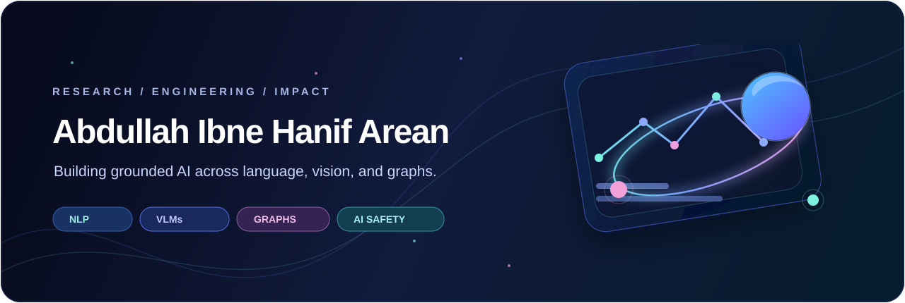
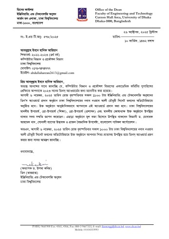
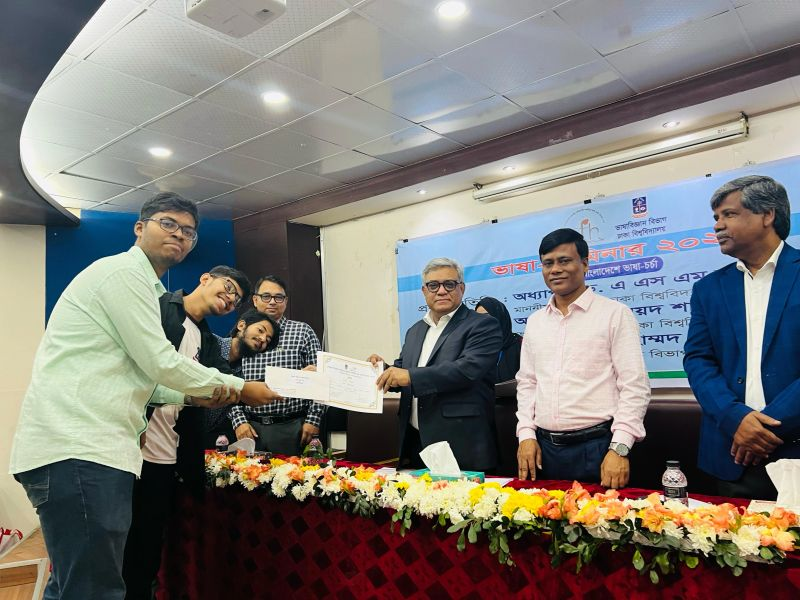
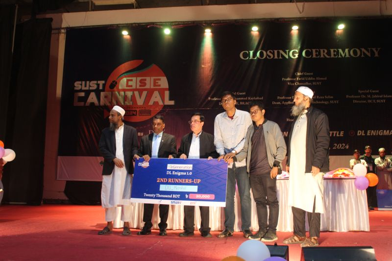

  

  
  
  
  

  <b>AI researcher and engineer from Dhaka, Bangladesh</b> 
  I build reliable AI systems for low-resource languages, visual reasoning, graph learning, and multilingual safety.

  
  
  

## Now

- Completing an **M.Sc. in Computer Science & Engineering** at the University of Dhaka. My thesis explores **streaming graph recommendation with drift-gated knowledge control**.
- Leading the **Registered Graduate Enrollment Portal** at the University of Dhaka - a live platform for enrolment, eligibility verification, and Senate-election preparation.
- Exploring grounded vision-language reasoning, low-resource NLP, continual graph learning, and native multilingual LLM safety evaluation.

## Research, with a reliability lens

| Area | What I investigate |
| :-- | :-- |
| **Vision-language models** | Topology verification, hallucination control, residual-stream analysis, and grounding audits for diagrams and video QA. |
| **Low-resource NLP** | Bangla translation, summarization, cultural knowledge evaluation, efficient fine-tuning, and multilingual safety. |
| **Graph learning** | Streaming recommendation, drift-aware knowledge control, low-rank adaptation, and GNNs. |
| **Trustworthy systems** | Evaluation design, safety testing, zero-knowledge identity, and accountable anonymity. |

### Published & accepted

1. **[Stroke-Level Connectivity Verification: Grounding Vision-Language Models Against Topology Hallucination](https://www.linkedin.com/posts/abdullaharean_icdar2026-documentanalysis-visionlanguagemodels-activity-7462140293249650689-WpDO)** - *ICDAR 2026 (oral)*. A method for checking diagram stroke links so a model cannot invent connections.
2. **[SOMAJGYAAN: Evaluating LLMs on Bangla Culture and Social Knowledge](https://aclanthology.org/2025.findings-ijcnlp.134/)** - *AACL-IJCNLP 2025 Findings*. A 4,234-question benchmark for culturally grounded Bangla LLM evaluation. **Equal contribution.**
3. **LocalTurn: Native Multi-Turn Safety Evaluation in Emirati Arabic, Bangla, Sinhala, and Yoruba** - *NeurIPS 2026 Workshop, LP4FM*. Native, multi-turn safety evaluation across eight commercial LLMs.

<b>Research in progress</b>

- **CLARITY** - document-level Bangla-English translation and cross-lingual summarization with Focal-Context Attention. *Under review at Nature Scientific Reports.*
- **DriftLA** - drift-gated low-rank adaptation for streaming graph recommendation. *Submitted to IEEE Access.*
- **Residual Stream Rebalancing** - training-free visual hallucination mitigation in VLMs. *Submitted to WACV 2027.*
- **When Detector-Based Grounding Metrics Measure Vocabulary** - an audit of entity claims in Video-QA reasoning traces. *Submitted to WACV 2027.*
- **Dependable Accountable Anonymity for Decentralized Identity** - zero-knowledge credential binding with threshold tracing. *Submitted to IEEE TDSC.*
- **Intelligent Defense Systems in the Cyberbio Nexus** - a review of AI-driven and non-AI biosecurity capabilities. *Submitted to Artificial Intelligence Review.*
- **When Should We Admit Generated Nodes?** - utility-guided few-shot learning on text-attributed graphs. *Submitted to ICLR 2027.*

## Experience

<table>
  <tr>
    <td width="50%" valign="top">
      <h3>PRISM</h3>
      <b>Research Fellow</b> 
      Jun 2026 - Sep 2026 · Remote
      
Designed multi-turn safety tests in Bangla, Sinhala, Arabic, and Yoruba; built a multilingual safety dataset and continuous scoring system.

    </td>
    <td width="50%" valign="top">
      <h3>The KOW Company</h3>
      <b>Junior AI Researcher</b> 
      Jun 2025 - Sep 2026 · Dhaka
      
Led research on VLM grounding and hallucination control, WACV submissions, and a drift-aware graph recommender.

    </td>
  </tr>
  <tr>
    <td width="50%" valign="top">
      <h3>University of Dhaka</h3>
      <b>Project Lead · Registered Graduate Enrollment Portal</b> 
      Aug 2026 - Present · Dhaka
      
Leading enrolment, graduate-record lookup, mobile OTP, pre-filled forms, eligibility checks, and public notices.

    </td>
    <td width="50%" valign="top">
      <h3>Cognitive Agents & Interaction Lab</h3>
      <b>Research Assistant</b> 
      Jan 2024 - May 2025 · University of Dhaka
      
Built Bangla NLP resources: MASBA (669K articles), a 50M+ sentence corpus, and LoRA-based translation and summarization systems.

    </td>
  </tr>
</table>

## Selected builds

| Project | A short version |
| :-- | :-- |
| **[PressWiz](https://cognistorm.ai/presswiz)** | Bangla news aggregation and summarization, powered by LongBanSum and the 669,699-article MASBA corpus. |
| **[Meramot](https://github.com/AbdullahArean/Meramot)** | A centralized portal for on-demand IT support, built with Java, Spring Boot, Spring MVC, and REST APIs. |
| **[Climate Relief](https://github.com/AbdullahArean/climaterelief)** | An Android app for disaster-relief distribution, resource tracking, and resilient offline data handling. |
| **[Uposthit](https://github.com/AbdullahArean/uposthit)** | An attendance system with biometric and QR check-in features and a JavaFX frontend. |

## Recognition & community

  
  
  

- **Dean's Award for Academic Excellence** - Faculty of Engineering, University of Dhaka (2025)
- **Champion**, Inter-University NLP Idea Competition; **1st Runner-Up**, Bhashamul; **2nd Runner-Up**, DL Enigma 1.0 (2024)
- **7th position**, Code Samurai 2024; **Finalist**, Code Samurai 2022; **Best Volunteer Award**, Dhaka University IT Society (2022)
- Former President of the **Dhaka University IT Society** and former Chair of the **IEEE Computer Society Student Branch, DU**. Across workshops on AI, academic search, PC building, and cybersecurity, I helped reach **2,000+ learners**.

## Toolkit

  

  
  

  <i>Open to research collaborations in multilingual AI safety, low-resource NLP, grounded multimodal reasoning, and graph learning.</i> 
  <a href="mailto:abdullaharean2613@gmail.com">Let’s connect →</a>

